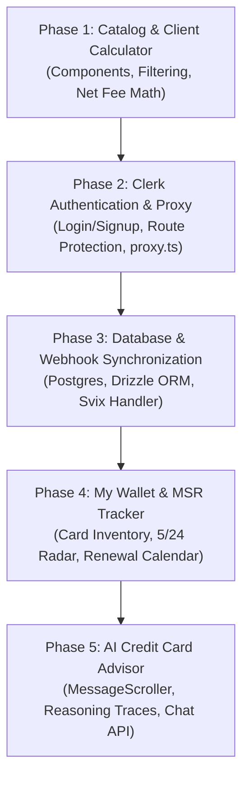

# Technical Requirements & Architectural Blueprint: Credit Card Dashboard

**Project:** Credit Card Dashboard Web Application  
**Author:** Firstmate Crewmate (arch-scout)  
**Date:** October 2026  
**Status:** Approved Architectural Specification  
**Deliverable Locations:**
- `/Users/christianauh/Desktop/Programming/Vibe-Slop/firstmate/data/arch-scout/report.md`
- `/Users/christianauh/Desktop/Programming/Vibe-Slop/firstmate/projects/credit-card-dashboard/docs/technical_architecture.md`

---

## 1. Executive Summary & System Objectives

### 1.1 Mission & Vision
The **Credit Card Dashboard** is an enterprise-grade financial management and reward optimization web application designed to empower consumers to navigate the increasingly complex credit card landscape. Modern credit card rewards are characterized by aggressive welcome offers ($200 to $2,800+ in value), complex point ecosystem valuations (1.0 cpp cash floors up to 2.0+ cpp transferable valuations), strict issuer anti-churning rules (Chase 5/24, Sapphire 48-month, Amex once-per-lifetime, Capital One 1/6), and rising annual fees offset by fragmented "coupon-book" statement credits.

The system serves as a unified command center that combines:
1. **Catalog & Discovery:** Multi-dimensional filtering and search across 33 premier credit cards.
2. **Interactive Rewards & Spend Calculator:** Real-time algorithmic yield computation across custom spending categories.
3. **Net Effective Annual Fee Analyzer:** True out-of-pocket holding cost calculation after user-discounted statement credits.
4. **MSR & SUB Tracker:** Minimum spend pacing, deadline monitoring, and issuer underwriting eligibility checks (e.g., Chase 5/24 radar).
5. **My Wallet / Portfolio Manager:** Card renewal alerts, credit perk redemption checklists, and credit utilization tracking.
6. **AI Credit Card Advisor:** An intelligent conversational assistant utilizing specialized ShadCN AI primitives (`message-scroller`, `message`, `bubble`, `trace`, `code-block`) providing personalized portfolio gap analysis and synergy recommendations.

### 1.2 Technology Stack Summary
- **Framework:** Next.js 16.4.2 (App Router, Turbopack, Async Request APIs, React Server Components)
- **Runtime & Language:** Node.js 20.9+ LTS, TypeScript 5+
- **Frontend UI & Styling:** React 19.3.1, Tailwind CSS v4 (`@tailwindcss/postcss`), ShadCN UI (`base-nova` style with `@base-ui/react`), Lucide React icons, Shiki syntax highlighter
- **AI Elements:** `@shadcn/react` AI components (`message-scroller`, `message`, `bubble`, `trace`, `code-block`, `attachment`)
- **Authentication:** Clerk (`@clerk/nextjs` v7.9+) with route protection and Svix webhook synchronization
- **Database & Persistence:** PostgreSQL (Supabase / Neon) with Drizzle ORM and connection pooling
- **Security Scope:** Strict Zero-PAN (Primary Account Number) architecture; no financial card numbers, expiration dates, or CVVs are ever ingested or stored.

```
+-----------------------------------------------------------------------------------+
|                                  NEXT.JS 16 APP ROUTER                            |
|                                                                                   |
|  +--------------------+  +----------------------+  +---------------------------+  |
|  |   Public Routes    |  |  Protected Dashboard |  |       AI Advisor          |  |
|  | /, /catalog, /calc |  | /dashboard, /wallet  |  | /advisor, /api/chat       |  |
|  +--------------------+  +----------------------+  +---------------------------+  |
|            |                        |                           |                 |
|  +---------v------------------------v---------------------------v--------------+  |
|  |           Authentication & Route Proxy (Clerk + Next.js 16 proxy.ts)        |  |
|  +-----------------------------------------------------------------------------+  |
|                                     |                                             |
|  +------------------v------------------------------------------+  |
|  |       Server Actions & Route Handlers (Drizzle ORM Data Access Layer)       |  |
|  +-----------------------------------------------------------------------------+  |
+-------------------------------------|---------------------------------------------+
                                      |
       +------------------------------+-------------------------------+
       |                                                              |
+------v------------------------------------+        +----------------v-------------+
|    PostgreSQL (Supabase / Neon)           |        |        External Webhooks     |
|  - Users & Profiles                       |        |  - Clerk Auth (Svix Verify)  |
|  - User Cards & Limits                    |        +------------------------------+
|  - MSR Campaigns & Spend Budgets          |
|  - Credit Redemptions & Saved Presets     |
+-------------------------------------------+
```

---

## 2. Feature Architecture & User Flows

### 2.1 Card Catalog & Discovery Engine

#### Feature Scope
The Card Catalog is fed by the foundational dataset `app/data/cards.json` containing 33 premier credit cards across all tiers (Top-Tier Travel, Mid-Tier Travel, Dining & Groceries, Everyday / Cash Back & Rotating, Hotel Co-Branded, Airline Co-Branded).

#### Filter & Search Architecture
- **Issuers:** Multi-select facet: Chase, American Express, Capital One, Citi, Wells Fargo, U.S. Bank, Bilt, Discover.
- **Annual Fee Tiers:**
  - $0 (No Annual Fee)
  - $1 – $99 (Entry / Mid Tier)
  - $100 – $394 (Premium Mid Tier)
  - $395+ (Luxury / Ultra-Premium)
  - *Dynamic Range Slider:* $0 to $895.
- **Reward Ecosystem / Currency:**
  - Transferable Bank Points: Chase Ultimate Rewards (UR), Amex Membership Rewards (MR), Capital One Miles, Citi ThankYou Points (TYP), Wells Fargo Rewards, Bilt Rewards.
  - Co-Branded Currencies: World of Hyatt, Marriott Bonvoy, Hilton Honors, IHG One Rewards, United MileagePlus, Delta SkyMiles, Southwest Rapid Rewards, American Airlines AAdvantage.
  - Cash Back (Fixed 1.0 cpp).
- **Core Benefits & Perks Checkboxes:**
  - 0% Foreign Transaction Fee (FTF)
  - Airport Lounge Access (Priority Pass Select, Centurion, Sapphire Lounge, Capital One Lounge)
  - Primary Auto Rental Collision Damage Waiver (CDW)
  - Complimentary Free Hotel Night Award
  - Airline Free Checked Bag Waiver
  - Cell Phone Protection
- **Category Multipliers:** Filter cards with $\ge 3\times$ or $\ge 4\times$ on specific categories (Dining, Groceries, Flights, Hotels, Gas/EV, Transit, Streaming, Catch-all).
- **Sort Options:**
  - Editorial Rating (Default, 5.0 scale)
  - Net Effective Annual Fee (Lowest to Highest)
  - Welcome Offer Value (Highest USD to Lowest)
  - Stated Annual Fee (Low to High / High to Low)
  - Catch-All Multiplier Rate

#### User Flow: Catalog Browsing & Action
```
[User Lands on /catalog]
         |
         v
[Faceted Filter Bar: Selects "No FTF", "Dining >= 3x", "Issuer: Chase, Amex"]
         |
         v
[Card Grid Dynamically Updates in Real-Time (Client State)]
         |
    +----+----------------------------------------+
    |                                             |
    v                                             v
[Click "View Details"]                 [Click "Add to Comparison"]
    |                                             |
    v                                             v
[Opens CardDetailSheet]                [Drawer docks card (Max 4)]
- Full statement credits breakdown                |
- Underwriting rules (5/24, etc.)                 v
- Pros/Cons & editorial verdict        [Navigate to /compare matrix]
```

---

### 2.2 Interactive Rewards & Category Spend Calculator

#### Algorithmic Foundation
The spend calculator calculates annualized point yield and net dollar value based on user-defined monthly category budgets:

$$\text{Annual Point Yield} = 12 \times \sum_{c \in \text{Categories}} \left( \text{Spend}_c \times \text{Multiplier}_{c, \text{card}} \right)$$

$$\text{Gross Reward Value (\$)} = \text{Annual Point Yield} \times \left( \frac{\text{Valuation cpp}}{100} \right)$$

$$\text{Net Annual Value (\$)} = \text{Gross Reward Value} + \text{Utilized Statement Credits} - \text{Annual Fee}$$

#### Spend Categories & Input Matrix
1. **Dining & Takeout:** Restaurants, cafes, bars, DoorDash, Uber Eats.
2. **Groceries & Supermarkets:** Traditional grocery stores (Whole Foods, Kroger, Trader Joe's).
3. **Flights (Direct Airline):** Airfare booked directly on carrier websites.
4. **Hotels (Direct Booking):** Lodging booked directly with hotel brands.
5. **Portal Travel:** Bookings routed through Chase Travel, Amex Travel, Capital One Travel, or Citi Travel.
6. **Gas & EV Charging:** Service stations, Tesla Superchargers, Electrify America.
7. **Transit & Commuting:** Rideshare (Uber, Lyft), subways, passenger rail, parking.
8. **Digital Entertainment & Streaming:** Netflix, Disney+, Spotify, Hulu.
9. **Catch-All / Everyday Spend:** Medical, insurance, utilities, tuition, general merchandise.

#### Valuation Modes (Toggleable by User)
- **Conservative Cash Floor (1.0 cpp):** Redemptions taken purely as statement credits or direct bank deposits (e.g., 10,000 points = $100).
- **US Credit Card Guide Transfer Benchmark (1.6 – 2.0+ cpp):** Outsized value achieved by transferring transferable bank points to partner airline and hotel programs (e.g., World of Hyatt at 2.0 cpp, Aeroplan/Flying Blue international business class awards at 1.8–2.2 cpp).

#### Preset Persona Profiles
- **Urban Foodie & Traveler:** $800 Dining, $400 Grocery, $300 Flights, $200 Hotels, $150 Transit, $50 Streaming, $500 Catch-all.
- **Suburban Family Commuter:** $400 Dining, $1,000 Grocery, $100 Flights, $100 Hotels, $350 Gas/EV, $60 Streaming, $1,200 Catch-all.
- **High-Volume Business Flyer:** $1,200 Dining, $300 Grocery, $1,500 Flights, $1,000 Hotels, $200 Gas, $300 Transit, $2,000 Catch-all.
- **Frugal Cash-Back Maximizer:** $200 Dining, $400 Grocery, $50 Flights, $50 Hotels, $150 Gas, $30 Streaming, $600 Catch-all.

#### Portfolio / Trifecta Optimization Engine
When switched to "Portfolio Mode", the engine evaluates card synergies:
- **The Chase Trifecta:** Automatically routes Dining to Sapphire Reserve/Preferred (3x), rotating quarterly bonus to Freedom Flex (5x), and unbonused spend to Freedom Unlimited (1.5x), pooled into Chase Ultimate Rewards at 1.6–2.0 cpp.
- **The Amex Trifecta:** Routes Flights to Amex Platinum (5x), Dining & US Supermarkets to Amex Gold (4x), and Catch-all to Blue Business Plus (2x MR up to $50k).
- **The Capital One Duo:** Routes Dining/Grocery/Entertainment to Capital One Savor (3%), converted 1:1 into Venture X miles; all other purchases to Venture X (flat 2x).
- **The Citi Trifecta:** Routes highest spend category to Citi Custom Cash (5% up to $500/mo), Dining/Supermarket/Gas/Travel to Strata Premier (3x), and Catch-all to Double Cash (2%).

---

### 2.3 Net Effective Annual Fee Analyzer

#### The Friction Problem
Premium luxury cards advertise high annual fees alongside massive headline statement credits:
- **Amex Platinum:** $895 Annual Fee vs. $2,804 in potential credits.
- **Chase Sapphire Reserve:** $795 Annual Fee vs. $2,264 in potential credits.
- **Capital One Venture X:** $395 Annual Fee vs. $520 in potential credits.
- **Marriott Bonvoy Brilliant:** $650 Annual Fee vs. $1,020 in potential credits.

However, consumers rarely capture 100% of fragmented credits (e.g., $7/mo Dunkin' Donuts, $25/mo DoorDash non-restaurant credits, $100/quarter Resy credits). Without systematic tracking, cards with nominal positive value become major cash drains.

#### Net Effective Fee Formula
$$\text{Net Effective Fee} = \text{Stated Annual Fee} - \sum_{i} \left( \text{Credit}_i \times \text{User Utility Discount}_i \right)$$

#### Interactive Credit Ledger & Friction Weights
Each card credit in `cards.json` includes frequency metadata:
- `Annual`: Full single-use credit (e.g., CSR $300 travel credit, Venture X $300 travel credit). Low friction ($0.90 - $1.00 weight).
- `Semi-Annual`: Split into two equal tranches (e.g., Sapphire Reserve The Edit $250 x 2 = $500; Amex Platinum Lodging $300 x 2 = $600). Moderate friction ($0.60 - $0.80 weight).
- `Quarterly`: Split into 4 tranches (e.g., Amex Platinum Resy $100 x 4 = $400; Lululemon $75 x 4 = $300). High friction ($0.40 - $0.70 weight).
- `Monthly`: Split into 12 monthly allotments (e.g., Amex Gold $10/mo Uber Cash + $10/mo Dining = $240; CSR $35/mo DoorDash = $420). Extreme friction ($0.30 - $0.60 weight).
- `Every 4 Years`: Amortized over 48 months (e.g., $120 Global Entry = $30/year).

#### UI Waterfall Breakdown
The analyzer provides an interactive checklist where users check which credits they utilize and adjust the perceived value percentage. The dashboard immediately renders a dynamic Waterfall graphic displaying:
- Gross Annual Fee (Red)
- High-Utility Travel Credits (Green Offset)
- Lifestyle / Dining Credits (Green Offset)
- Final Net Out-of-Pocket Holding Cost (Positive or Negative Value)

---

### 2.4 Sign-Up Bonus (SUB) & MSR Tracker

#### MSR Mechanics & Tracking Engine
A Minimum Spend Requirement (MSR) requires spending an exact dollar amount within a precise calendar timeframe (typically 90 days or 180 days).

Critical engine constraints:
1. **Annual Fee Exclusion:** The annual fee does NOT count toward the spend requirement.
2. **Refund Safety Buffer:** The engine automatically enforces a recommended $300 buffer to prevent returns or automatic statement credits from triggering bonus clawbacks.
3. **Pace Monitoring:**
   $$\text{Remaining Spend} = \text{Target MSR} - \text{Logged Eligible Spend}$$
   $$\text{Days Remaining} = \text{Deadline Date} - \text{Current Date}$$
   $$\text{Required Daily Pace} = \frac{\text{Remaining Spend}}{\text{Days Remaining}}$$
   The UI outputs a real-time status indicator:
   - *On Track (Green):* Current daily spend rate $\ge$ Required daily pace.
   - *At Risk (Amber):* Behind pace by $< 20\%$.
   - *Critical (Red):* Behind pace by $\ge 20\%$ or $< 14$ days remaining with $> 25\%$ spend unfulfilled.

#### Issuer Underwriting Rules & Eligibility Radar
The dashboard includes an integrated rules simulator:
- **Chase 5/24 Rule:**
  - Evaluates all personal credit cards opened in the past 24 rolling months.
  - Automatically flags Chase cards as:
    - *Eligible (e.g., 3/24)*
    - *Borderline (4/24 - "Recommend opening Chase card immediately before dropping slot")*
    - *Blocked (5/24 or higher - "Auto-denial by Chase underwriting")*
  - Projected Drop-Off Radar: Displays exact calendar dates when accounts cross the 24-month threshold, opening future application slots.
- **Chase Sapphire 48-Month Rule:** Enforces check on prior Sapphire bonus receipt date and prevents holding both CSP and CSR simultaneously.
- **Amex Once-Per-Lifetime & Family Rules:**
  - Detects if user already holds or previously held Amex Platinum, Amex Gold, or Amex Green.
  - Warns against applying for Gold after Platinum to prevent family language disqualification.
- **Capital One 1/6 & 2-Card Rule:** Blocks recommendations if a Capital One personal card was opened in the preceding 6 months or if 2 personal cards are active.
- **Citi 8/65 & 1/48 Rules:** Enforces 8-day spacing between single applications and 65-day spacing between dual applications.

---

### 2.5 My Wallet / Portfolio Manager

#### Feature Modules
1. **Active Inventory:**
   - Card nickname, issuer, network, tier.
   - Account open date, statement closing date, annual fee renewal date.
   - Credit limit and current balance (for utilization calculations).
2. **Annual Fee Renewal Radar:**
   - Visual timeline displaying cards renewing within 30, 60, and 90 days.
   - Retention Guidance Generator: Generates card-specific retention negotiation talking points (e.g., "Remind phone representative of low travel credit usage and inquire about spend retention offers: 20k UR or $150 credit").
   - Downgrade Path Mapper: Suggests no-annual-fee product change routes (e.g., Chase Sapphire Reserve $\rightarrow$ Chase Freedom Unlimited; Amex Gold $\rightarrow$ cancel or downgrade; Citi Strata Premier $\rightarrow$ Citi Custom Cash) to preserve credit line and credit history age.
3. **Credit Utilization Monitor:**
   - Aggregate Credit Line vs. Total Outstanding Balance.
   - Per-Card Utilization Percentage.
   - Visual tiers: Optimal ($< 10\%$), Safe ($10\% - 29\%$), High Warning ($\ge 30\%$).
4. **Perks & Statement Credit Check-off Ledger:**
   - Dynamic monthly and quarterly checklist (e.g., "October 2026: Amex Gold $10 Uber Cash [X], $10 Grubhub [ ], $7 Dunkin' [ ]").
   - Push/email notification triggers prior to monthly reset.

---

### 2.6 AI Credit Card Advisor

#### System Architecture & Prompt Flow
The AI Credit Card Advisor is an embedded conversational assistant built on top of the project's specialized ShadCN AI elements. It analyzes user wallet data, monthly spend budgets, 5/24 status, and credit goals to synthesize customized financial recommendations.

```
+-------------------------------------------------------------------------------+
|                             AI ADVISOR CHAT VIEW                              |
|                                                                               |
|  [MessageScroller]                                                            |
|    +-- [Message align="start"]                                                |
|          +-- [MessageHeader]: AI Credit Advisor                               |
|          +-- [MessageContent]                                                 |
|                +-- [Bubble variant="tinted"]:                                 |
|                      "I analyzed your $2,400 monthly spend. You're currently  |
|                       earning only 1.5% on $800 in monthly groceries..."     |
|                +-- [Trace]:                                                   |
|                      +-- [TraceLine status="complete"]: Extracted Spend Data  |
|                      +-- [TraceLine status="complete"]: Evaluated 5/24 Status |
|                      +-- [TraceCollapsible]:                                  |
|                            - Simulating Amex Gold 4x: 38,400 MR ($614/yr)     |
|                            - Simulating Citi Custom Cash 5%: $300 cash/yr     |
|                            - Net Effective Fee Comparison                     |
|                +-- [CodeBlock]:                                               |
|                      | Card       | Multiplier | Gross Return | Net Value |   |
|                      |------------|------------|--------------|-----------|   |
|                      | Amex Gold  | 4x MR      | $614         | $289      |   |
|                      | Savor Cash | 3% Cash    | $288         | $288      |   |
|    +-- [Message align="end"]                                                  |
|          +-- [MessageContent]                                                 |
|                +-- [Bubble variant="default"]:                                |
|                      "Should I get the Amex Gold or the Savor?"               |
+-------------------------------------------------------------------------------+
```

#### Advisor Core Capabilities
1. **Category Gap Analysis:** Pinpoints the user's highest spending category currently earning base catch-all rewards (1x or 1.5%) and models the marginal return of introducing a dedicated card.
2. **Synergy / Trifecta Engine:** Recommends the missing piece of a multi-card setup (e.g. recommending Chase Freedom Unlimited to complete a Chase Trifecta).
3. **Application Roadmap & Churning Sequencer:** Plans a multi-month application strategy that maximizes welcome bonuses while strictly complying with issuer rules (e.g., "You are at 4/24. Apply for the Chase Ink Business Unlimited or Sapphire Preferred first before dropping off 5/24, then acquire the Capital One Venture X").
4. **Execution Tracing:** Exposes intermediate reasoning steps using `<Trace>` and `<TraceLine>` so users can audit the math behind the recommendation.

---

## 3. Component Catalog & Layout Specification

### 3.1 Global Application Shell & Layout Tree

```
app/
├── layout.tsx                # Root layout with ThemeProvider & ClerkProvider
├── globals.css               # Tailwind CSS v4 + Base Nova variables
├── page.tsx                  # Home landing & hero overview
├── (auth)/
│   ├── sign-in/[[...sign-in]]/page.tsx
│   └── sign-up/[[...sign-up]]/page.tsx
├── (dashboard)/
│   ├── layout.tsx            # Authenticated App Shell with Header & Nav
│   ├── dashboard/page.tsx    # Primary Overview (Metrics, Active MSR, 5/24 Gauge)
│   ├── catalog/page.tsx      # Full Card Catalog & Filter Engine
│   ├── calculator/page.tsx   # Interactive Spend & Rewards Yield Calculator
│   ├── wallet/page.tsx       # Portfolio Manager & Renewal Calendar
│   ├── compare/page.tsx      # Side-by-Side Comparison Matrix
│   └── advisor/page.tsx      # Dedicated AI Credit Card Advisor Chat Interface
└── api/
    ├── chat/route.ts         # Streaming AI Advisor Route Handler
    └── webhooks/clerk/route.ts # Svix Webhook Sync
```

### 3.2 UI Primitives Mapping

The project's UI layer in `components/ui/` leverages modern Base UI primitives (`@base-ui/react`) and the ShadCN `base-nova` style. Below is the mapping of components to application features:

| ShadCN UI Primitive | File Path | Application Use Cases |
| :--- | :--- | :--- |
| **Button** | `components/ui/button.tsx` | Primary action triggers, filter chips, drawer toggles, export buttons |
| **Card** | `components/ui/card.tsx` | Card catalog tiles, financial metric summaries, perk cards, MSR trackers |
| **Table** | `components/ui/table.tsx` | Side-by-side comparison matrix, transfer partner master lookup, fee breakdown |
| **Tabs** | `components/ui/tabs.tsx` | Catalog tier switching (Travel, Dining, Hotel, Airline), Calculator modes |
| **Sheet** | `components/ui/sheet.tsx` | Slide-over Card Detail Drawer, Mobile Navigation drawer, Slide-over AI chat |
| **Dialog** | `components/ui/dialog.tsx` | Add Card to Wallet modal, Custom Spend Entry modal, Confirmation prompts |
| **Progress** | `components/ui/progress.tsx` | MSR Spend Completion Bar, Credit Utilization Gauge, 5/24 status bar |
| **Badge** | `components/ui/badge.tsx` | Multiplier tags (`4x Dining`), Issuer tags, 0% FTF indicator, Tier markers |
| **Input & InputGroup** | `components/ui/input.tsx`, `input-group.tsx` | Category spend currency fields with `$` prefix, catalog keyword search |
| **Select** | `components/ui/select.tsx` | Sort dropdown, Preset selector, Ecosystem dropdown |
| **Switch** | `components/ui/switch.tsx` | Credit checklist toggles, 0% FTF filter, Cash vs Transfer valuation mode |
| **Separator** | `components/ui/separator.tsx` | Visual grouping in card details, sheets, and sidebar dividers |
| **Popover & HoverCard** | `components/ui/popover.tsx`, `hover-card.tsx` | Credit detail popovers, Rule explanations (e.g. hovering over "5/24" badge) |
| **Tooltip** | `components/ui/tooltip.tsx` | Helper tooltips on friction discounts, MSR buffers, and point valuations |
| **Collapsible** | `components/ui/collapsible.tsx` | Filter group expanding, statement credit category lists, FAQ sections |
| **Skeleton** | `components/ui/skeleton.tsx` | Async loading states for user wallet data and card catalog fetches |
| **Avatar** | `components/ui/avatar.tsx` | User profile representation, AI advisor bot icon |

### 3.3 AI Advisor Component Suite Integration

The project has integrated ShadCN AI elements designed for high-performance conversational interfaces:

1. **`message-scroller.tsx`:**
   - Primitives: `MessageScroller`, `MessageScrollerViewport`, `MessageScrollerContent`, `MessageScrollerItem`.
   - Built on `@shadcn/react/message-scroller`.
   - Provides virtualized, auto-scrolling conversation logs with stable scroll-anchoring, scroll-to-bottom buttons, and memory-efficient message rendering.
2. **`message.tsx`:**
   - Primitives: `MessageGroup`, `Message`, `MessageAvatar`, `MessageContent`, `MessageHeader`, `MessageFooter`.
   - Handles alignment (`data-align="start"` for AI advisor, `data-align="end"` for user).
3. **`bubble.tsx`:**
   - Primitives: `BubbleGroup`, `Bubble`, `BubbleContent`.
   - Variants: `default`, `secondary`, `muted`, `tinted`, `outline`, `ghost`, `destructive`.
   - Formats user prompts with crisp `default` styling and AI advice with readable `tinted` or `secondary` styling.
4. **`trace.tsx`:**
   - Primitives: `Trace`, `TraceLine`, `TraceIcon`, `TraceTitle`, `TraceDescription`, `TraceCollapsible`.
   - Status indicators: `running` (with animated shimmer), `pending`, `error`, `complete`.
   - Crucial for financial transparency: displays the AI advisor's internal reasoning stages (spend calculation, 5/24 check, partner valuation math) in a collapsible accordian.
5. **`code-block.tsx` & `lib/highlighter.tsx`:**
   - Primitives: `CodeBlock`, `CodeBlockHeader`, `CodeBlockTitle`, `CodeBlockContent`.
   - Leverages Shiki with pre-compiled grammar syntax highlighting.
   - Formats markdown financial summary tables, portfolio JSON exports, and simulation logs with integrated copy-to-clipboard functionality.
6. **`attachment.tsx`:**
   - Primitives: `Attachment`, `AttachmentPreview`, `AttachmentRemove`.
   - Allows users to drag-and-drop or upload CSV spend exports or credit card statement summaries for AI ingestion.

---

## 4. Backend Architecture & Client Data Storage Evaluation

### 4.1 Data Storage Requirements
To provide persistent multi-device access, the application must store:
1. **User Profiles:** Clerk `user_id` linkage, email, display preferences, credit score tier, home airport.
2. **User Card Portfolios:** Specific cards owned, card nicknames, open dates, renewal dates, credit limits, active status.
3. **MSR Campaigns:** Target spend, deadline, logged progress, status (`active`, `completed`, `expired`).
4. **Custom Spend Budgets:** User-configured monthly spending allocations across 9 categories.
5. **Credit Redemption Logs:** Tracking statement credits used in specific billing cycles (e.g. marking Amex Gold Uber Cash used in October 2026).
6. **Saved Comparisons & Custom Presets:** User-curated card comparisons.

### 4.2 Comparative Evaluation of Next.js 16 Compatible Backends

| Dimension | PostgreSQL + Drizzle ORM (Supabase / Neon) | PostgreSQL + Prisma ORM | SQLite / Turso (libSQL) | Serverless Key-Value (Upstash Redis) |
| :--- | :--- | :--- | :--- | :--- |
| **Next.js 16 Compatibility** | **Superior** (Edge & Node.js runtimes, zero-overhead, instant cold start) | **Moderate** (Engine binary overhead in serverless, larger bundle size) | **Good** (LibSQL edge client, lightweight) | **Limited** (Unsuitable for relational queries/joins) |
| **Relational Queries & Joins** | **Full SQL** (Effortless joins across user cards, credits, and spend logs) | **Full SQL** (Fluent syntax, heavier query engine) | **Full SQL** (SQLite dialect, lacks native array types) | **None** (Requires custom manual indexing and serialization) |
| **Schema Migrations** | **Drizzle Kit** (TypeScript-native, clean SQL migrations, fast diffing) | **Prisma Migrate** (Robust, shadow DB requirement for some providers) | **Turso Migrations** | **Manual / None** |
| **Connection Pooling** | **Built-in** (Supavisor / Neon WebSocket pooled driver) | **Requires Accelerate** or PgBouncer | **Embedded / HTTP** | **HTTP REST API** |
| **Type Safety** | **100% Inferred** from TypeScript schema definition | Generated TypeScript client | Inferred or manual | Manual casting |
| **Cost & Serverless Tier** | Generous free tier (Supabase 500MB / Neon 0.5 GB, scale-to-zero) | Dependent on hosted Postgres | Generous free tier (9GB storage, 1B reads) | High cost per write/read at scale |

#### Decision & Recommendation
**Recommended Stack:** **PostgreSQL (Supabase or Neon) with Drizzle ORM**.
- **Rationale:** 
  1. *Performance:* Drizzle compiles directly to lightweight SQL queries with zero runtime overhead, making it ideal for Next.js 16 Server Actions and Route Handlers without serverless cold-start penalties.
  2. *Relational Integrity:* Card portfolios inherently require relational integrity (users $\rightarrow$ cards $\rightarrow$ MSR campaigns $\rightarrow$ credit redemptions).
  3. *Type Safety:* Drizzle schemas act as the single source of truth for both database migrations and Zod validation schemas.
  4. *Connection Pooling:* Supabase (Supavisor) and Neon natively handle serverless connection bursts over port 6543 (transaction pooling) or WebSocket proxies.

### 4.3 Security, Privacy & PCI De-Scoping Architecture

> [!IMPORTANT]
> **Strict Non-PCI Compliance Architecture:**
> The Credit Card Dashboard is strictly an **advisory and portfolio intelligence tool**. It is **NOT** a payment processor, wallet issuer, or payment gateway.

1. **Absolute Zero-PAN Storage:**
   - Under no circumstances does the application collect, process, transmit, or store Primary Account Numbers (16-digit PAN), Card Verification Values (CVV/CVC), PINs, or magnetic stripe/chip data.
   - User cards are stored purely as abstract references: `card_id` (e.g., `"chase-sapphire-reserve"` referencing the static catalog) plus user-entered metadata:
     - User-chosen nickname (e.g., `"My Everyday Dining Card"`)
     - Approximate credit limit (e.g., `$10,000`)
     - Open date (YYYY-MM-DD for 5/24 calculations)
     - Annual renewal month (for calendar alerts)
2. **Tenant Isolation & Row-Level Security (RLS):**
   - Every database table storing personal records includes a non-nullable `user_id` column mapped to the verified Clerk authentication ID (`user_2...`).
   - All Drizzle queries in Server Actions enforce `where(eq(userCards.userId, session.userId))`.
   - In Supabase, Row-Level Security (RLS) policies enforce that requests using user JWTs can only read and write rows where `auth.uid() = user_id`.
3. **Data Minimization:**
   - Spend records are stored as aggregated category budgets (e.g. "Dining: $600/month"), not transaction-level bank feeds, keeping financial privacy at the highest level.

### 4.4 Production Drizzle Database Schema Outline

```typescript
// db/schema.ts
import { pgTable, text, timestamp, numeric, boolean, date, uuid, integer, jsonb } from "drizzle-orm/pg-core";
import { relations } from "drizzle-orm";

// 1. Core Users Table (Synchronized from Clerk Webhooks)
export const users = pgTable("users", {
  id: text("id").primaryKey(), // Clerk User ID: user_2...
  email: text("email").notNull().unique(),
  firstName: text("first_name"),
  lastName: text("last_name"),
  imageUrl: text("image_url"),
  createdAt: timestamp("created_at", { withTimezone: true }).defaultNow().notNull(),
  updatedAt: timestamp("updated_at", { withTimezone: true }).defaultNow().notNull(),
});

// 2. User Profiles & Preferences
export const userProfiles = pgTable("user_profiles", {
  userId: text("user_id").primaryKey().references(() => users.id, { onDelete: "cascade" }),
  creditScoreRange: text("credit_score_range").default("Excellent (720+)"),
  preferredEcosystem: text("preferred_ecosystem").default("chase_ur"), // chase_ur, amex_mr, capone_miles, citi_typ, cashback
  homeAirport: text("home_airport"),
  valuationMode: text("valuation_mode").default("transfer_benchmark"), // transfer_benchmark vs cash_floor
  monthlySpendBudget: numeric("monthly_spend_budget", { precision: 12, scale: 2 }).default("0"),
  updatedAt: timestamp("updated_at", { withTimezone: true }).defaultNow().notNull(),
});

// 3. User Card Portfolio
export const userCards = pgTable("user_cards", {
  id: uuid("id").defaultRandom().primaryKey(),
  userId: text("user_id").notNull().references(() => users.id, { onDelete: "cascade" }),
  cardSlug: text("card_slug").notNull(), // References id in cards.json (e.g., 'chase-sapphire-reserve')
  nickname: text("nickname"),
  openedAt: date("opened_at").notNull(), // Used for 5/24 calculations
  renewalDate: date("renewal_date"),
  creditLimit: numeric("credit_limit", { precision: 12, scale: 2 }),
  currentBalance: numeric("current_balance", { precision: 12, scale: 2 }).default("0"),
  isActive: boolean("is_active").default(true).notNull(),
  isAuthorizedUser: boolean("is_authorized_user").default(false).notNull(),
  createdAt: timestamp("created_at", { withTimezone: true }).defaultNow().notNull(),
});

// 4. Sign-Up Bonus (MSR) Campaigns
export const msrCampaigns = pgTable("msr_campaigns", {
  id: uuid("id").defaultRandom().primaryKey(),
  userCardId: uuid("user_card_id").notNull().references(() => userCards.id, { onDelete: "cascade" }),
  userId: text("user_id").notNull().references(() => users.id, { onDelete: "cascade" }),
  bonusName: text("bonus_name").notNull(), // e.g. "100,000 Points Welcome Offer"
  targetSpend: numeric("target_spend", { precision: 12, scale: 2 }).notNull(),
  currentSpend: numeric("current_spend", { precision: 12, scale: 2 }).default("0").notNull(),
  deadline: date("deadline").notNull(),
  status: text("status", { enum: ["active", "completed", "expired"] }).default("active").notNull(),
  createdAt: timestamp("created_at", { withTimezone: true }).defaultNow().notNull(),
});

// 5. User Monthly Category Spend Budgets
export const userSpendBudgets = pgTable("user_spend_budgets", {
  id: uuid("id").defaultRandom().primaryKey(),
  userId: text("user_id").notNull().references(() => users.id, { onDelete: "cascade" }),
  dining: numeric("dining", { precision: 10, scale: 2 }).default("0").notNull(),
  groceries: numeric("groceries", { precision: 10, scale: 2 }).default("0").notNull(),
  flights: numeric("flights", { precision: 10, scale: 2 }).default("0").notNull(),
  hotels: numeric("hotels", { precision: 10, scale: 2 }).default("0").notNull(),
  travelPortal: numeric("travel_portal", { precision: 10, scale: 2 }).default("0").notNull(),
  gas: numeric("gas", { precision: 10, scale: 2 }).default("0").notNull(),
  transit: numeric("transit", { precision: 10, scale: 2 }).default("0").notNull(),
  streaming: numeric("streaming", { precision: 10, scale: 2 }).default("0").notNull(),
  catchAll: numeric("catch_all", { precision: 10, scale: 2 }).default("0").notNull(),
  updatedAt: timestamp("updated_at", { withTimezone: true }).defaultNow().notNull(),
});

// 6. Statement Credit Redemptions Log
export const creditRedemptions = pgTable("credit_redemptions", {
  id: uuid("id").defaultRandom().primaryKey(),
  userCardId: uuid("user_card_id").notNull().references(() => userCards.id, { onDelete: "cascade" }),
  userId: text("user_id").notNull().references(() => users.id, { onDelete: "cascade" }),
  creditName: text("credit_name").notNull(), // e.g. "Uber Cash ($10)"
  amount: numeric("amount", { precision: 8, scale: 2 }).notNull(),
  periodKey: text("period_key").notNull(), // e.g. "2026-10" or "2026-Q4" or "2026"
  redeemedAt: timestamp("redeemed_at", { withTimezone: true }).defaultNow().notNull(),
});

// Relations
export const usersRelations = relations(users, ({ one, many }) => ({
  profile: one(userProfiles, { fields: [users.id], references: [userProfiles.userId] }),
  cards: many(userCards),
  spendBudget: one(userSpendBudgets, { fields: [users.id], references: [userSpendBudgets.userId] }),
}));

export const userCardsRelations = relations(userCards, ({ one, many }) => ({
  user: one(users, { fields: [userCards.userId], references: [users.id] }),
  msrCampaigns: many(msrCampaigns),
  creditRedemptions: many(creditRedemptions),
}));
```

---

## 5. Clerk Authentication Integration Strategy

### 5.1 Next.js 16 App Router Setup
Clerk provides first-class support for Next.js 16 and React 19.

#### Installation
```bash
npm install @clerk/nextjs svix
```

#### Environment Configuration (`.env.local`)
```env
NEXT_PUBLIC_CLERK_PUBLISHABLE_KEY=pk_test_...
CLERK_SECRET_KEY=sk_test_...
CLERK_WEBHOOK_SECRET=whsec_...

NEXT_PUBLIC_CLERK_SIGN_IN_URL=/sign-in
NEXT_PUBLIC_CLERK_SIGN_UP_URL=/sign-up
NEXT_PUBLIC_CLERK_AFTER_SIGN_IN_URL=/dashboard
NEXT_PUBLIC_CLERK_AFTER_SIGN_UP_URL=/dashboard
```

#### Provider Setup in `app/layout.tsx`
```tsx
// app/layout.tsx
import { ClerkProvider } from "@clerk/nextjs";
import { ThemeProvider } from "@/components/theme-provider";
import "./globals.css";

export default function RootLayout({ children }: { children: React.ReactNode }) {
  return (
    <ClerkProvider
      appearance={{
        variables: {
          colorPrimary: "oklch(0.205 0 0)",
        },
      }}
    >
      <html lang="en" suppressHydrationWarning>
        <body>
          <ThemeProvider>{children}</ThemeProvider>
        </body>
      </html>
    </ClerkProvider>
  );
}
```

### 5.2 Next.js 16 Route Protection: `proxy.ts` vs. `middleware.ts`

> [!NOTE]
> **Next.js 16 Convention Note:**
> In Next.js 16, the `middleware` file convention is deprecated in favor of `proxy.ts` running on the `nodejs` runtime. However, `@clerk/nextjs` `clerkMiddleware()` functions as standard request interception. When deploying on Edge, `middleware.ts` remains active; when migrating to the Node.js boundary, `proxy.ts` is used.

#### Implementation: `middleware.ts` / `proxy.ts`
```typescript
// middleware.ts (or proxy.ts in Next.js 16)
import { clerkMiddleware, createRouteMatcher } from "@clerk/nextjs/server";

const isPublicRoute = createRouteMatcher([
  "/",
  "/catalog(.*)",
  "/calculator(.*)",
  "/compare(.*)",
  "/sign-in(.*)",
  "/sign-up(.*)",
  "/api/webhooks(.*)",
]);

export default clerkMiddleware(async (auth, req) => {
  if (!isPublicRoute(req)) {
    await auth.protect();
  }
});

export const config = {
  matcher: [
    // Skip Next.js internals and all static files
    "/((?!_next|[^?]*\\.(?:html?|css|js(?!on)|jpe?g|webp|png|gif|svg|ttf|woff2?|ico|csv|docx?|xlsx?|zip|webmanifest)).*)",
    // Always run for API routes
    "/(api|trpc)(.*)",
  ],
};
```

#### Async Request API Compatibility in Server Components
In Next.js 16, all Request APIs (`cookies()`, `headers()`, `params`, `searchParams`) are strictly asynchronous. Clerk's `auth()` helper adheres to this:

```tsx
// app/(dashboard)/wallet/page.tsx
import { auth, currentUser } from "@clerk/nextjs/server";
import { redirect } from "next/navigation";
import { db } from "@/db";
import { userCards } from "@/db/schema";
import { eq } from "drizzle-orm";

export default async function WalletPage() {
  const { userId } = await auth();

  if (!userId) {
    redirect("/sign-in");
  }

  const user = await currentUser();
  const cards = await db.select().from(userCards).where(eq(userCards.userId, userId));

  return (
    <div className="container mx-auto p-6 space-y-6">
      <h1 className="text-2xl font-bold">My Wallet ({cards.length} Cards)</h1>
      {/* Wallet components */}
    </div>
  );
}
```

### 5.3 Webhook Synchronization via Svix

To ensure local relational tables (`users`, `user_profiles`, `user_spend_budgets`) stay perfectly synchronized with Clerk accounts without runtime roundtrips to Clerk's REST API, a dedicated webhook endpoint handles `user.created`, `user.updated`, and `user.deleted` events.

```typescript
// app/api/webhooks/clerk/route.ts
import { Webhook } from "svix";
import { headers } from "next/headers";
import { WebhookEvent } from "@clerk/nextjs/server";
import { db } from "@/db";
import { users, userProfiles, userSpendBudgets } from "@/db/schema";
import { eq } from "drizzle-orm";

export async function POST(req: Request) {
  const WEBHOOK_SECRET = process.env.CLERK_WEBHOOK_SECRET;

  if (!WEBHOOK_SECRET) {
    throw new Error("Missing CLERK_WEBHOOK_SECRET in environment variables");
  }

  // Next.js 16: headers() is asynchronous
  const headerPayload = await headers();
  const svix_id = headerPayload.get("svix-id");
  const svix_timestamp = headerPayload.get("svix-timestamp");
  const svix_signature = headerPayload.get("svix-signature");

  if (!svix_id || !svix_timestamp || !svix_signature) {
    return new Response("Missing svix headers", { status: 400 });
  }

  const payload = await req.json();
  const body = JSON.stringify(payload);

  const wh = new Webhook(WEBHOOK_SECRET);
  let evt: WebhookEvent;

  try {
    evt = wh.verify(body, {
      "svix-id": svix_id,
      "svix-timestamp": svix_timestamp,
      "svix-signature": svix_signature,
    }) as WebhookEvent;
  } catch (err) {
    console.error("Error verifying webhook:", err);
    return new Response("Webhook verification failed", { status: 400 });
  }

  const eventType = evt.type;

  if (eventType === "user.created") {
    const { id, email_addresses, first_name, last_name, image_url } = evt.data;
    const primaryEmail = email_addresses?.[0]?.email_address;

    if (!primaryEmail) {
      return new Response("No email address provided", { status: 400 });
    }

    // Atomic creation of user, default profile, and initial spend budget
    await db.transaction(async (tx) => {
      await tx.insert(users).values({
        id,
        email: primaryEmail,
        firstName: first_name ?? null,
        lastName: last_name ?? null,
        imageUrl: image_url ?? null,
      });

      await tx.insert(userProfiles).values({
        userId: id,
        creditScoreRange: "Excellent (720+)",
        preferredEcosystem: "chase_ur",
        monthlySpendBudget: "2500.00",
      });

      await tx.insert(userSpendBudgets).values({
        userId: id,
        dining: "600.00",
        groceries: "500.00",
        flights: "250.00",
        hotels: "150.00",
        travelPortal: "0.00",
        gas: "150.00",
        transit: "100.00",
        streaming: "50.00",
        catchAll: "700.00",
      });
    });
  }

  if (eventType === "user.updated") {
    const { id, email_addresses, first_name, last_name, image_url } = evt.data;
    const primaryEmail = email_addresses?.[0]?.email_address;

    await db.update(users).set({
      email: primaryEmail,
      firstName: first_name ?? null,
      lastName: last_name ?? null,
      imageUrl: image_url ?? null,
      updatedAt: new Date(),
    }).where(eq(users.id, id));
  }

  if (eventType === "user.deleted") {
    const { id } = evt.data;
    if (id) {
      // Cascades automatically delete userProfiles, userCards, budgets via DB foreign keys
      await db.delete(users).where(eq(users.id, id));
    }
  }

  return new Response("Webhook processed successfully", { status: 200 });
}
```

### 5.4 Metadata Management & User Profile Lifecycle
- **Clerk `publicMetadata`:** Used for lightweight flags consumed in client routing without database lookups:
  - `onboardingCompleted: boolean`
  - `tier: "free" | "pro"`
- **Clerk UI Elements:**
  - Standard `<UserButton />` in header provides built-in profile editing, multi-factor authentication (MFA) setup, session management, and sign-out.
  - Seamless dark mode matching via Clerk's `appearance.baseTheme` aligned with `next-themes`.

---

## 6. Implementation Roadmap & Phased Execution Plan



### Phase 1: Core Shell, Catalog & Static Calculator (Client-Only)
- Deploy responsive App Shell (`app/(dashboard)/layout.tsx`) with brand navigation, header, theme toggle.
- Build `CardCatalog` view (`app/(dashboard)/catalog/page.tsx`) with faceted multi-select filters and card grid using `Card`, `Badge`, `Button`, `Sheet`.
- Build `CardDetailSheet` displaying full annual credits, protections, transfer partners, and issuer rules.
- Build `SpendCalculator` (`app/(dashboard)/calculator/page.tsx`) with 9 category inputs (`InputGroup`), persona presets, cpp valuation toggle, and dynamic net yield calculation.
- Build `NetEffectiveFeeAnalyzer` modal with interactive statement credit check-off ledger.

### Phase 2: Clerk Authentication & Route Protection
- Install `@clerk/nextjs`.
- Configure `middleware.ts` / `proxy.ts` with `createRouteMatcher` separating public vs protected routes.
- Build customized `/sign-in` and `/sign-up` pages in `app/(auth)/`.
- Add `<UserButton />` and user status pill to the global navigation header.

### Phase 3: Database Provisioning, Drizzle ORM & Webhook Sync
- Configure Supabase or Neon PostgreSQL instance.
- Define Drizzle schema (`db/schema.ts`) for `users`, `user_profiles`, `user_cards`, `msr_campaigns`, `user_spend_budgets`, `credit_redemptions`.
- Generate and run migrations using `drizzle-kit push`.
- Deploy `/api/webhooks/clerk/route.ts` with Svix signature verification.
- Test user lifecycle sync (create, update, delete).

### Phase 4: My Wallet, MSR Tracker & 5/24 Engine
- Build `app/(dashboard)/wallet/page.tsx`:
  - "Add Card to Wallet" dialog selecting from the 33 cards in `cards.json`.
  - MSR Active Campaign tracker with daily spend pace calculator (`Progress` bar).
  - 5/24 Status Radar with historical card open dates and countdown to drop-off dates.
  - Annual Fee Renewal Radar with retention call script generator.
  - Monthly statement credit redemption checklist.

### Phase 5: AI Credit Card Advisor
- Build `app/(dashboard)/advisor/page.tsx` and slide-over AI assistant using ShadCN AI elements:
  - `MessageScroller` + `MessageScrollerViewport` for virtualized conversational scroll.
  - `Message` + `Bubble` with `tinted` styling for AI responses.
  - `Trace` + `TraceCollapsible` showing step-by-step financial reasoning and calculation runs.
  - `CodeBlock` with Shiki syntax highlighting for comparison matrices and yield tables.
- Implement `/api/chat/route.ts` with structured system prompt injecting user's wallet cards, spend profile, and `cards.json` catalog.

---

## 7. Verification, Risk Analysis & Conclusion

### 7.1 Key Risks & Mitigation Strategies
1. **Issuer Policy Volatility:** Credit card welcome offers, fees, and statement credits change dynamically.
   - *Mitigation:* The card catalog is strictly decoupled in `app/data/cards.json` with versioning metadata (`lastUpdated: "2026-10"`). Subsequent administrative tooling can update this JSON or sync from an external CMS without application redeployment.
2. **PCI Compliance Scope Creep:**
   - *Mitigation:* Strict zero-PAN architecture. The frontend validation schema explicitly rejects any 15-16 digit numerical sequences or CVV formats.
3. **Next.js 16 Architectural Shifts:**
   - *Mitigation:* Adherence to async Request APIs (`await auth()`, `await headers()`, `await params`), Turbopack-compatible module boundaries, and `revalidateTag(tag, 'max')` cache profile conventions.

### 7.2 Conclusion
This technical architecture provides a complete, robust, and modern blueprint for the Credit Card Dashboard web application. By pairing Next.js 16 and Tailwind CSS v4 with Base UI/ShadCN primitives, Clerk authentication, PostgreSQL via Drizzle ORM, and high-performance ShadCN AI elements, the application is positioned to deliver unprecedented financial clarity, reward yield optimization, and actionable intelligence to credit card holders.
